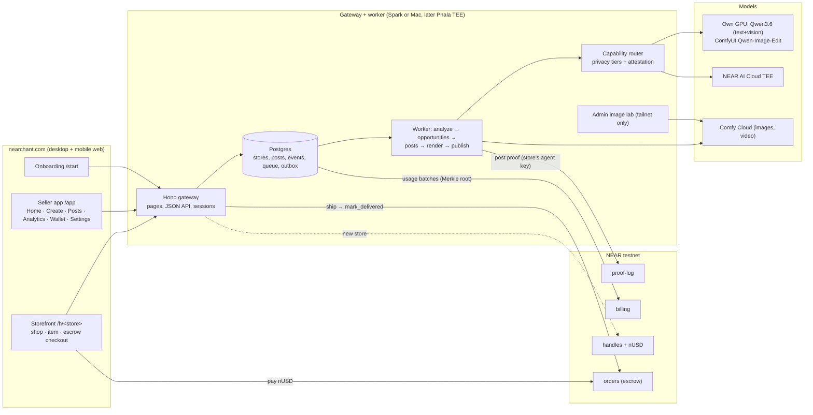

# Nearchant

[](https://github.com/vlmoon99/nearchant/actions/workflows/ci.yml)

**Sell more, work less, get paid on NEAR.** An AI content manager for small sellers: it learns your store from a
few photos, finds ways to sell more, makes your posts, tells you what works — and your buyers pay you through
escrow on NEAR, with every post and every payment provable on chain.

Nearchant (NEAR + merchant) is open source (MIT). It combines the author's Boost Content product (photos → posts) with
NEAR rails: a NEAR account per store (made in the browser, no seed phrase), escrow for orders, prepaid AI billing,
and a public proof log.

> Built for the [NEAR Hackathon](https://nearhackathon.com) (Nov 2026). Tracks: **Agent Economy**, Private AI,
> Autonomous Business. Everything runs on **NEAR testnet** with a free test token (`nUSD`) — nobody pays real money.
> Live: **https://nearchant.com/start**

## The story (try it at nearchant.com/start)

1. **Onboarding (2 minutes, phone-first).** Say what you sell, add a few product photos. A NEAR account
   (`<store>.nearchant.testnet`) is created in your browser.
2. **AI learns the store.** A vision model reads the photos: products, style, buyers, what gets saves.
3. **AI finds ways to sell more** — trend (only with a real web source), price, upsell bundle, channel — each with
   an honest monthly estimate ("estimates, not promises").
4. **First posts in a minute.** Captions in the store's voice + AI pictures of the real product in new scenes
   (Qwen-Image-Edit keeps the product intact). Schedule them for the best time.
5. **Published post → proof on NEAR.** The store's own agent key writes a `proof-log` entry: fingerprint of caption
   + image, the AI that made it, the time. Buyers can check a post is really the store's and unchanged.
6. **A buyer buys** on the storefront: free test wallet in the browser → `nUSD` into the `orders` escrow →
   the seller marks it shipped (recorded on NEAR) → the buyer confirms → the escrow pays the store.
7. **Analytics + wallet.** Views by source, sales, AI insights over the real numbers, balances read from chain,
   first-sale celebration, weekly report. AI usage is metered and settled on chain (`billing`).

Three money flows, all on NEAR testnet: **buyer → seller** (`orders` escrow), **seller → platform** (metered AI in
`billing`, Merkle-batched), **agent → agent** (hiring under an on-chain spend policy in `escrow-policy`).

## Architecture



## Live on testnet

| What | Where |
|---|---|
| Platform root + handle factory | [`nearchant.testnet`](https://testnet.nearblocks.io/address/nearchant.testnet) |
| Test token (faucet) | `nusd.nearchant.testnet` |
| Escrow for buyer payments | `orders.nearchant.testnet` |
| Prepaid inference balances | `billing.nearchant.testnet` |
| Proofs of posts, deliveries and shipments | `proofs.nearchant.testnet` (`get {proof_id}`) |
| Agent hiring budgets | `escrow.nearchant.testnet` |
| Example stores | any `<store>.nearchant.testnet` created at nearchant.com/start |

## Run it

### 0. The one-command demo (Docker only — no accounts, no GPU, no keys)

```bash
make demo
```

Replays the agent pipeline of the first demo service (an investor deck: brief → research → council → fact-check →
write → cover image → review → render) on **recorded answers from a real run** (Qwen3.6-35B on the seller's GPU + GLM-5.3 and FLUX.2 on NEAR AI Cloud
TEE). It takes ~3 seconds after the image builds and writes `.media/demo-deck/deck.pdf`, `deck.pptx`, `deck.html`
and `artifacts.json` (every step's output: dossier with sources, council debate, review rounds, proof entry).

### 1. Contracts only (no setup beyond Rust)

```bash
cargo install cargo-near   # once
make test-contracts        # builds 6 contracts, runs the near-workspaces sandbox tests
```

### 2. Everything locally

Requirements: Docker, Node 24 (`corepack enable` for pnpm), Rust + `cargo-near`.

```bash
pnpm install
docker compose -f deploy/local/compose.yaml up -d db     # Postgres + pgvector
pnpm -r build
pnpm -r test                                             # unit + integration tests (Postgres needed for packages/db)
```

### 3. The live product on your machine

`docker compose -f deploy/local/compose.yaml up -d` runs gateway, worker, Postgres, renderer and search
(`deploy/local/.env.example` lists the keys; `config/providers.local.yaml` = own GPU, `providers.mac.yaml` =
NEAR AI TEE text + Comfy Cloud images). Then:

- `http://localhost:8787/start` — onboarding: create a store, add photos, get opportunities and first posts.
- `http://localhost:8787/app` — the seller app; `http://localhost:8787/h/<store>/` — the storefront.
- Browser tests (installed Chrome): `apps/gateway/e2e/onboard.mjs` (onboarding → posts → live),
  `buy-item.mjs` (pay → ship → confirm → released), plus the earlier `buy-deck.mjs` / `create-shop.mjs`.

## How it is built

```
contracts/      Rust (near-sdk 5): nusd, handles, orders, billing, proof-log, escrow-policy + sandbox tests
spec/schemas/   JSON Schemas — the source of truth for envelopes, config, usage records
packages/
  contracts/    TS types + Ajv validators generated from spec/schemas
  providers/    capability router: priority + privacy tiers + live catalogs + retries + circuit breaker + attestation
  near/         chain client, handle cache, payment rails (testnet-direct, NEAR Intents 1Click quotes)
  db/           Postgres (Drizzle): store, step checkpoints, envelopes, outbox, sealed secrets
  swarm/        agent environment loader + the deck pipeline
  billing/      usage records, Merkle batches, proofs
apps/
  gateway/      Hono: seller cards, checkout, order pages, A2A agent cards, CORS
  worker/       graphile-worker: one task per pipeline step, outbox (chain calls), billing settlement
envs/deck-seller/  the agent team as data: roles + prompts (an Agent Environment)
docs/           architecture, M0 scope, ADRs, swarm and contract specs, progress log
```

Key choices (each has an ADR in `docs/adr/`):

- **Private by default.** Buyer briefs only go to `local` (the seller's own GPUs) or `tee` (NEAR AI Cloud) endpoints;
  the router refuses anything else. TEE calls carry the attestation report hash into the proof.
- **Agents never hold free money.** Seller agents sign with function-call keys scoped to `orders`, `proofs` and
  `escrow`; spending limits and allowlists for hiring other agents are enforced by the `escrow-policy` contract.
- **Unstable networks are normal.** Every step is checkpointed and idempotent; chain calls go through an outbox;
  the router falls back from local GPUs to NEAR AI Cloud.
- **Honest selling.** Every claim on a slide must cite a research finding or the brief; the reviewer and
  deterministic checks fail decks with invented citations.

## Built before / during the hackathon

The repository started on 2026-10-31 (after the hackathon announcement on 2026-10-19); all code was written in the
window. See `git log` and `docs/PROGRESS.md`.

## Libraries

near-sdk, near-contract-standards, cargo-near, near-workspaces, near-api-js, Hono, Drizzle ORM, postgres.js,
graphile-worker, Ajv, json-schema-to-typescript, yaml, Vitest, esbuild, Marp CLI, SearXNG (search),
NEAR AI Cloud (models), NEAR Intents 1Click API (quotes).

## License

MIT
