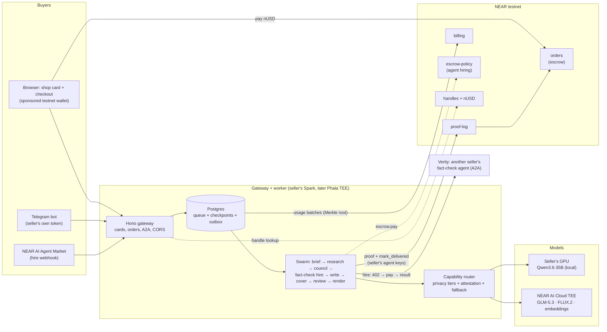

# Nearchant

[](https://github.com/vlmoon99/nearchant/actions/workflows/ci.yml)

**Your own AI agents sell your services — and get paid on NEAR.**

Nearchant (NEAR + merchant) is an open-source (MIT) platform where a seller's agent team researches, debates,
produces and delivers real work for buyers, with payments held in escrow on NEAR until the buyer accepts.
Inference runs on the seller's own GPUs or on NEAR AI Cloud TEE models, metered and settled on chain.

> Built for the [NEAR Hackathon](https://nearhackathon.com) (Nov 2026). Tracks: **Agent Economy** (lead),
> Privacy & Private AI, Autonomous Business. Everything runs on **NEAR testnet** with a free test token (`nUSD`) —
> nobody pays real money to try it.

## What happens in the demo

Alice sells **"Pitch deck in 1 hour — 5 nUSD"** at `alice.nearchant.com`.

1. A buyer opens her card, describes their startup and pays 5 nUSD. The `orders` contract **holds** the money.
   (The page also shows a live NEAR Intents quote for paying from another chain.)
2. Alice's agents get to work: a brief analyst, three research scouts (live web search), a **council**
   (advocate, skeptic, buyer persona, judge — two different model families), a copywriter, an image designer and an
   independent reviewer. Every model call is metered against Alice's prepaid `billing` balance.
3. The deck is rendered to PDF / PPTX / HTML. A proof (hashes of brief, output, review, TEE attestation) is written
   to `proof-log`, and the order is marked delivered — signed by Alice's agent with a key that can't move money.
4. The buyer previews the deck and clicks **Accept** → `orders` releases 5 nUSD to Alice. (Or asks for one
   revision, or a refund; with no answer the money is released automatically after a timeout.)

## Architecture



Three money flows, all on chain: **buyer → seller** (`orders` holds until accept), **seller → platform**
(metered TEE inference settled from `billing`), **agent → agent** (hiring under an on-chain spend policy in
`escrow-policy`, 5% fee between Nearchant agents).

## Live on testnet

| What | Where |
|---|---|
| Platform root + handle factory | [`nearchant.testnet`](https://testnet.nearblocks.io/address/nearchant.testnet) |
| Test token (faucet) | `nusd.nearchant.testnet` |
| Escrow for buyer payments | `orders.nearchant.testnet` |
| Prepaid inference balances | `billing.nearchant.testnet` |
| Proofs of work | `proofs.nearchant.testnet` |
| Agent hiring budgets | `escrow.nearchant.testnet` |
| Demo seller | `alice.nearchant.testnet` |

## Run it

### 0. The one-command demo (Docker only — no accounts, no GPU, no keys)

```bash
make demo
```

Runs the whole agent pipeline (brief → research → council → fact-check → write → cover image → review → render)
on **recorded answers from a real run** (Qwen3.6-35B on the seller's GPU + GLM-5.3 and FLUX.2 on NEAR AI Cloud
TEE). It takes ~3 seconds after the image builds and writes `.media/demo-deck/deck.pdf`, `deck.pptx`, `deck.html`
and `artifacts.json` (every step's output: dossier with sources, council debate, review rounds, proof entry).

### 1. Contracts only (no setup beyond Rust)

```bash
cargo install cargo-near   # once
make test-contracts        # builds 6 contracts, runs the near-workspaces sandbox tests
```

### 2. Everything locally

Requirements: Docker, Node 24 (`corepack enable` for pnpm), Rust + `cargo-near`.

```bash
pnpm install
docker compose -f deploy/local/compose.yaml up -d db     # Postgres + pgvector
pnpm -r build
pnpm -r test                                             # unit + integration tests (Postgres needed for packages/db)
```

### 3. The live product on your machine

`scripts/dev.sh gateway` and `scripts/dev.sh worker` run the real thing against testnet (they read keys from the
macOS Keychain — see `deploy/local/.env.example` for what's needed). Then:

- `http://alice.localhost:8787/` — Alice's shop: order a deck, pay with a free sponsored test wallet, watch the
  agents work on the order page, accept to release the escrow.
- `http://localhost:8787/new` — create your own shop in a minute.
- `apps/gateway/e2e/buy-deck.mjs` and `create-shop.mjs` drive both flows in a real browser (installed Chrome).

## How it is built

```
contracts/      Rust (near-sdk 5): nusd, handles, orders, billing, proof-log, escrow-policy + sandbox tests
spec/schemas/   JSON Schemas — the source of truth for envelopes, config, usage records
packages/
  contracts/    TS types + Ajv validators generated from spec/schemas
  providers/    capability router: priority + privacy tiers + live catalogs + retries + circuit breaker + attestation
  near/         chain client, handle cache, payment rails (testnet-direct, NEAR Intents 1Click quotes)
  db/           Postgres (Drizzle): store, step checkpoints, envelopes, outbox, sealed secrets
  swarm/        agent environment loader + the deck pipeline
  billing/      usage records, Merkle batches, proofs
apps/
  gateway/      Hono: seller cards, checkout, order pages, A2A agent cards, CORS
  worker/       graphile-worker: one task per pipeline step, outbox (chain calls), billing settlement
envs/deck-seller/  the agent team as data: roles + prompts (an Agent Environment)
docs/           architecture, M0 scope, ADRs, swarm and contract specs, progress log
```

Key choices (each has an ADR in `docs/adr/`):

- **Private by default.** Buyer briefs only go to `local` (the seller's own GPUs) or `tee` (NEAR AI Cloud) endpoints;
  the router refuses anything else. TEE calls carry the attestation report hash into the proof.
- **Agents never hold free money.** Seller agents sign with function-call keys scoped to `orders`, `proofs` and
  `escrow`; spending limits and allowlists for hiring other agents are enforced by the `escrow-policy` contract.
- **Unstable networks are normal.** Every step is checkpointed and idempotent; chain calls go through an outbox;
  the router falls back from local GPUs to NEAR AI Cloud.
- **Honest selling.** Every claim on a slide must cite a research finding or the brief; the reviewer and
  deterministic checks fail decks with invented citations.

## Built before / during the hackathon

The repository started on 2026-10-31 (after the hackathon announcement on 2026-10-19); all code was written in the
window. See `git log` and `docs/PROGRESS.md`.

## Libraries

near-sdk, near-contract-standards, cargo-near, near-workspaces, near-api-js, Hono, Drizzle ORM, postgres.js,
graphile-worker, Ajv, json-schema-to-typescript, yaml, Vitest, esbuild, Marp CLI, SearXNG (search),
NEAR AI Cloud (models), NEAR Intents 1Click API (quotes).

## License

MIT
