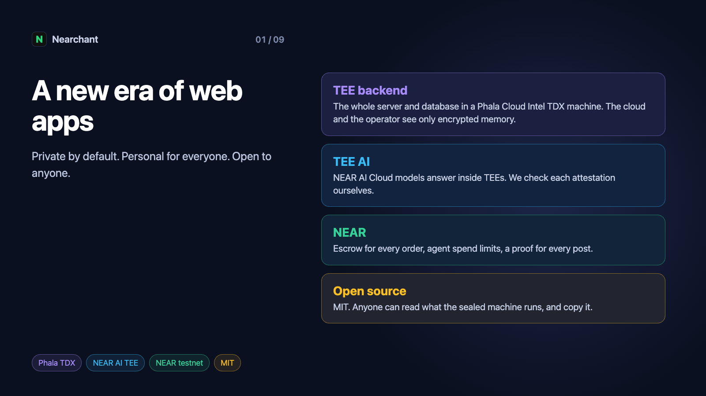
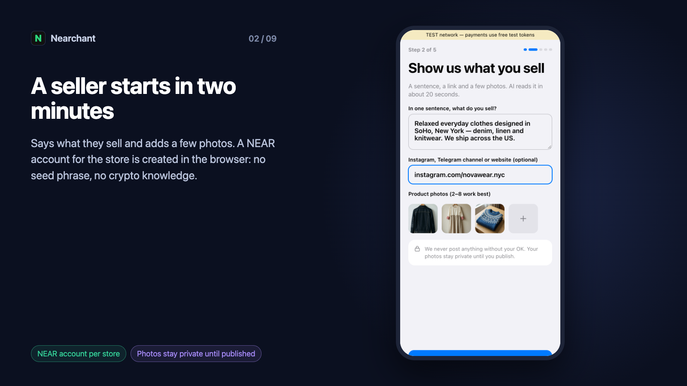
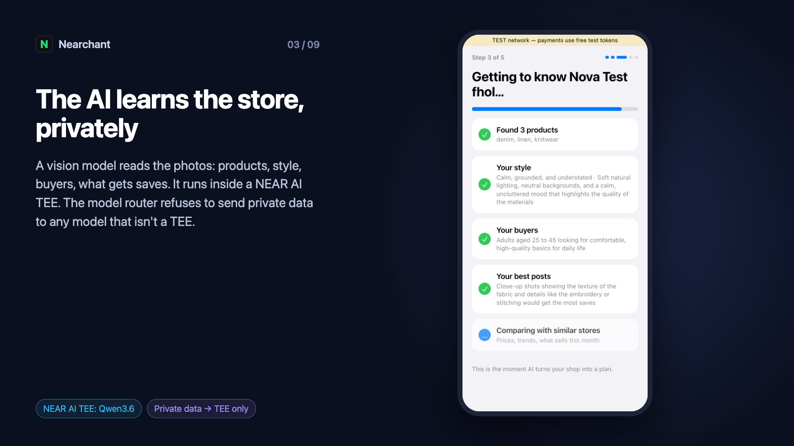
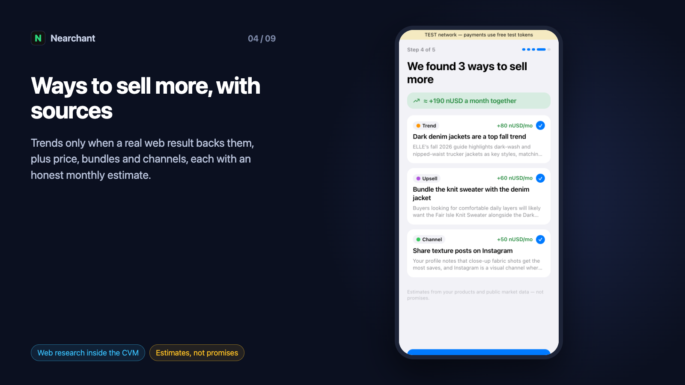
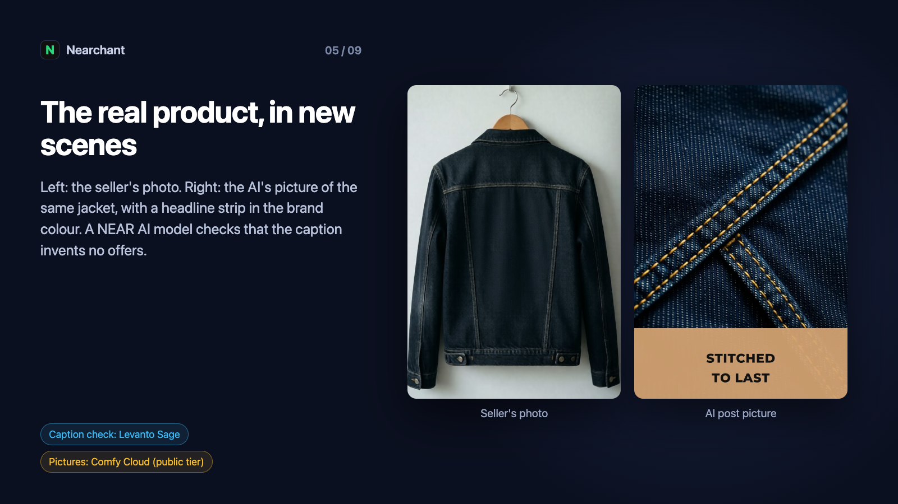
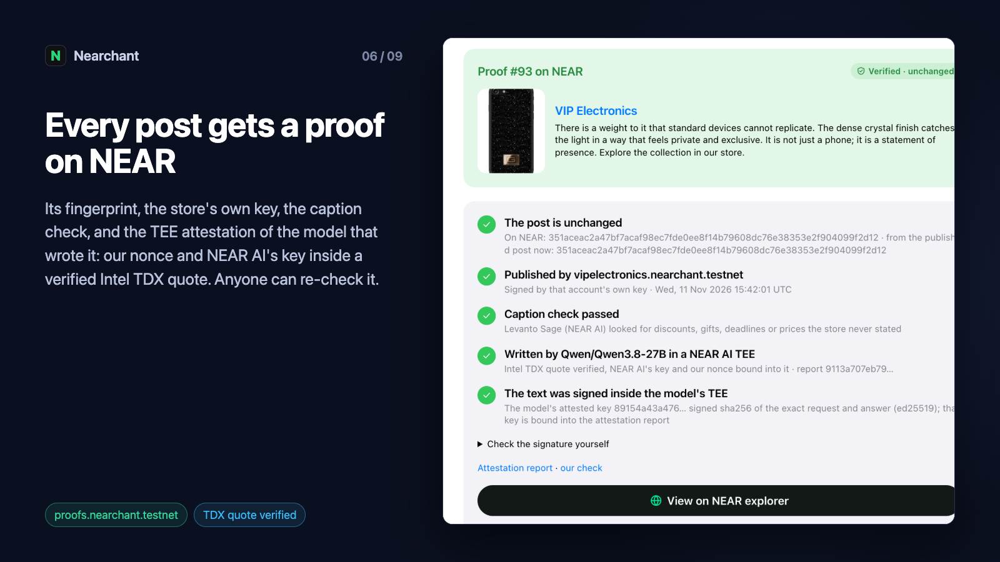
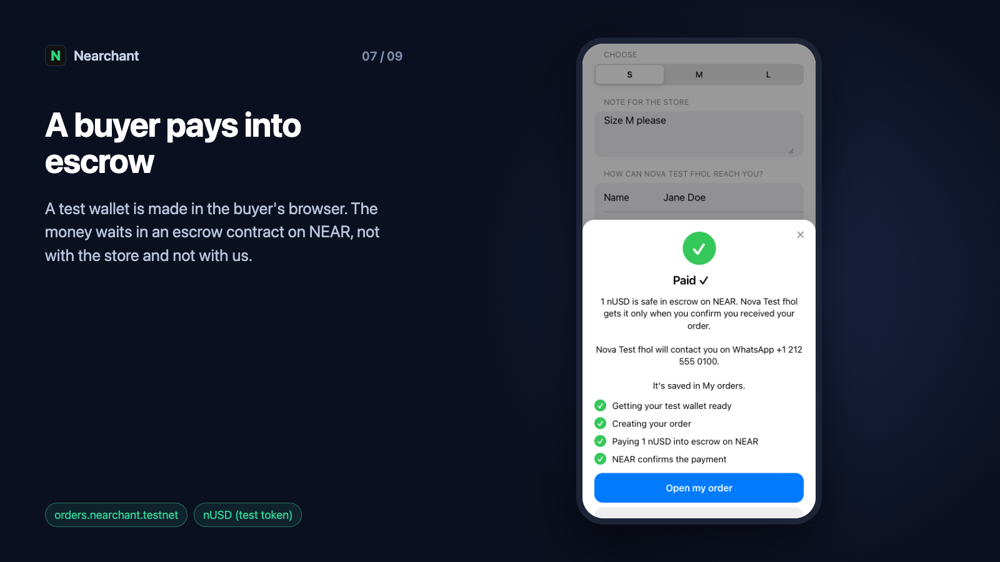
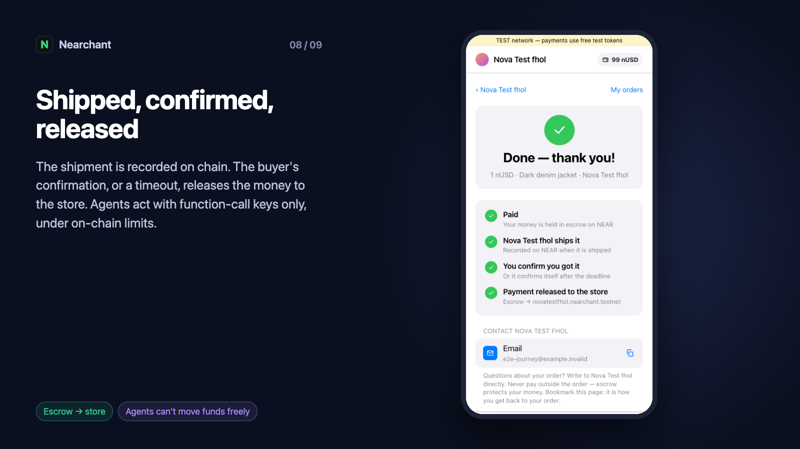
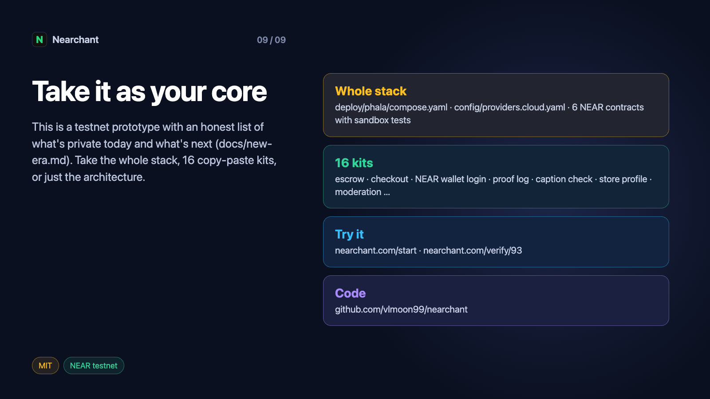
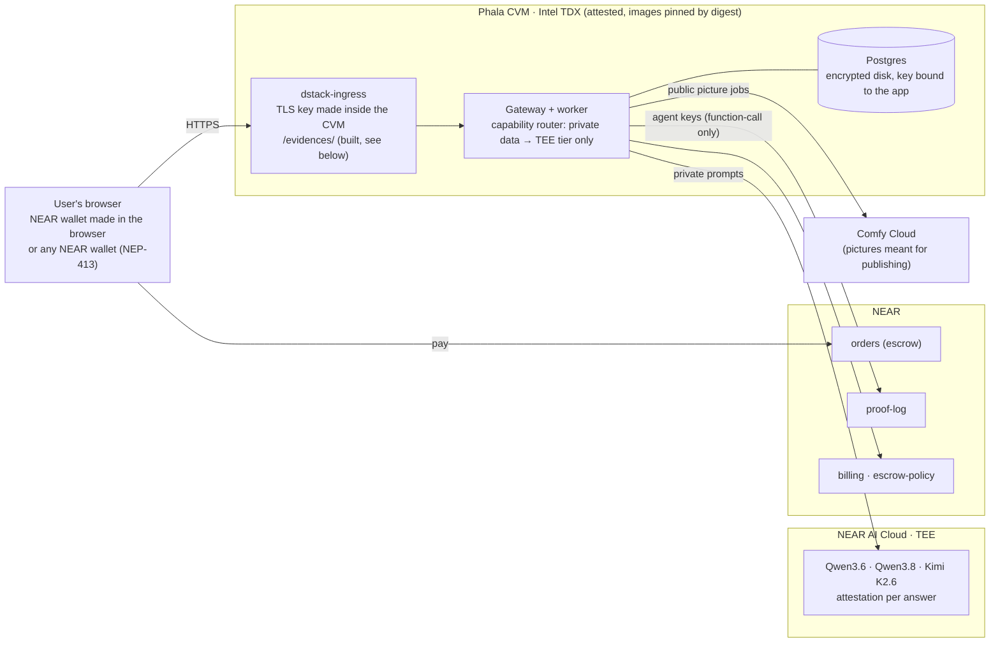

# A New Era of Web Applications

**Private by default, personal for everyone, open to anyone.** Nearchant is a working prototype of how web
applications will be built over the next 20–30 years. It runs on NEAR testnet, and every line is MIT-licensed.

## The idea

For 25 years a web app has meant: your data goes to someone's server, their staff and their vendors can read it,
and you are asked to trust a privacy policy. AI makes that deal worse. A useful assistant has to read your
photos, your sales, your messages and your plans, and today all of that goes to a model provider in the clear.

People want two things that used to contradict each other:

- **An app that knows them deeply** and does real work for them: personal agents, not generic chat.
- **A guarantee that nobody else can see their data**, including the company that runs the app.

Three technologies now make both possible at once, and together they are stronger than any one of them:

| Piece | What it gives | In Nearchant |
|---|---|---|
| **TEE backend** (Phala Cloud, Intel TDX) | The whole server — app, worker, database — runs in a sealed machine. The host, the cloud and the operator see only encrypted memory and disk. A signed quote proves which exact code is running. | Gateway, worker, Postgres, image client, search and renderer in one CVM. Images pinned by digest, so the attestation names exactly what runs. |
| **TEE AI inference** (NEAR AI Cloud) | Models answer inside TEEs (Intel TDX + NVIDIA confidential GPUs). Prompts and answers are invisible to the model host. Each answer can be tied to an attestation report. | Every private call (photos, sales, buyer messages, briefs) goes only to NEAR AI TEE models. We fetch the attestation and **check it ourselves**: our nonce and NEAR AI's signing key inside the TDX quote, verified with Phala's DCAP verifier; GPU part through NVIDIA NRAS. |
| **Blockchain** (NEAR) | Money and promises that nobody has to trust a company for: payments, limits, proofs. Accounts that a person or an agent owns. | Escrow for every order; a NEAR account per store, made in the browser; agents sign with function-call keys only, under on-chain spend limits; every published post gets a proof on chain that anyone can re-check. |
| **Open source** | Anyone can read what the sealed machine runs, rebuild it, and check that the attested image is that code. Without this, a TEE only proves "some code" runs. | MIT. The images are built from this repo by CI; the compose file with their digests is in `deploy/phala/`. 16 parts are packaged as copy-paste kits. |

The combination is the point. A TEE without open source proves nothing a user can understand. Private AI without a
private backend leaks at the server. A blockchain without private compute exposes everything it touches.
Together: **the user's data is processed only by code anyone can read, in machines nobody can look into, and the
money and promises are enforced by a public ledger.**

That is a better product, not just a safer one. Once a user doesn't have to worry about their data, an app can
ask for much more of it — and give back a level of personalisation and help that wasn't acceptable before.

## What Nearchant shows

A small seller (Instagram, Telegram) gets a team of AI agents with its own NEAR account:

1. **Add a few product photos.** A vision model in a NEAR AI TEE reads them: products, style, buyers, voice.
2. **Ways to sell more:** trends (only with a real web source), price, bundles, honest estimates.
3. **Posts:** captions in the store's voice, the real product drawn in new scenes, a check that the caption doesn't
   invent offers (Levanto Sage on NEAR AI).
4. **Proof on NEAR** for every published post: fingerprint, model, the TEE attestation it ran under. Anyone can
   re-check it at `nearchant.com/verify/<id>`.
5. **A buyer pays** into the escrow contract from a wallet made in the browser; shipment is recorded on chain; the
   buyer's confirmation (or a timeout) releases the money to the store.
6. **Buyers find stores** through an AI shop feed; each store's own assistant answers them from public facts only.
7. **Agents moderate** the marketplace while the owner sleeps, and hire other agents under an on-chain budget.

It's one example. The same stack fits a clinic's assistant, a tutor, a personal finance agent, a dating app, a
legal helper — any app where the AI is only as good as the private data it may read.

## The story in nine pictures

From a live run on nearchant.com (13 Nov 2026): a new store, its posts, a buyer paying into escrow, the money released.

## Architecture

## Honest status: what is private today, and what is next

This is a prototype on testnet, not a production service. We'd rather show the edges than hide them.

| Data path | Today | Next |
|---|---|---|
| Server, worker, database | Inside the Phala TDX CVM. | Production OS image: the CVM now runs a **dev** image, which lets the operator open a shell. |
| Private AI (photos, sales, messages, briefs) | NEAR AI TEE models only; the router refuses others; attestation checked by us per report. | Show the CVM's own attestation next to the model's on `/verify`. |
| Traffic from the browser | Through a Cloudflare tunnel: **Cloudflare decrypts it** on the way. | TLS inside the CVM is **built and running** (dstack-ingress, certificate key made in the TEE, real client IP via PROXY protocol, verified through Phala's passthrough address). Waiting on Phala's gateway to route our custom hostname; then the tunnel goes. |
| Pictures for posts | Comfy Cloud (not a TEE). Only pictures meant to be published, from photos the seller wants published. | A TEE image model when one is hosted. |
| Email sign-in and notices | Resend (sees the address and the notice). | Wallet sign-in already avoids it. |
| Money | NEAR testnet, a free test token (`nUSD`). | Mainnet with a real stablecoin. |

## Take it as your core

Everything here is meant to be copied:

- **The whole stack:** `deploy/phala/compose.yaml` is the CVM; `config/providers.cloud.yaml` is the private-AI
  routing (`private_data_allowed_tiers: [tee]`); `contracts/` are the six NEAR contracts with sandbox tests.
- **Just the parts:** [kits/](../kits/) — escrow, checkout, NEAR wallet login, proof log, caption check, store
  profile and ten more, each a folder you copy into your own app and that passes its tests on its own.
- **Just the architecture:** this page. TEE backend + TEE inference + NEAR + open source, wired so that private data
  never leaves attested machines and every promise is on a public ledger.

Try it: **[nearchant.com/start](https://nearchant.com/start)** · Check a post: **[nearchant.com/verify/93](https://nearchant.com/verify/93)**
