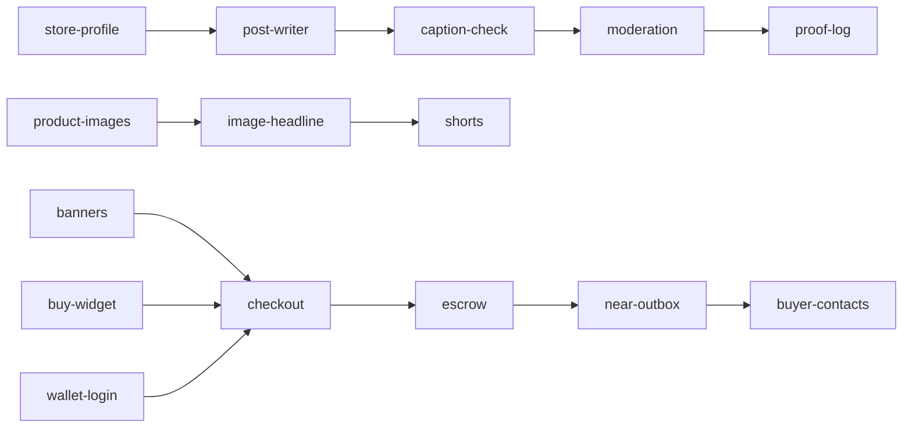

# Nearchant kits

The working parts of [Nearchant](https://nearchant.com), as folders you copy into your own project. Two topics:
**markets** (sell and get paid on NEAR) and **content** (AI that makes and checks a store's posts). Take one kit or
all of them; each stands alone.

**How to use any kit:** copy its folder into your project → run the `npm i …` line from its README (many need
nothing) → `import { … } from "./<kit>/src/index.js"`. Every kit has a README, tests and an `example.ts`
(`npx tsx example.ts`).

**Why you can trust the copy works:** `node kits/scripts/check-copy.mjs` copies every kit alone into an empty folder
outside this repo, installs only what its `package.json` lists, then typechecks and runs its tests. All 16 pass.
Rules every kit follows: [CONVENTIONS.md](CONVENTIONS.md).

## Markets: sell and get paid on NEAR

| Kit | What it gives you | Needs |
|---|---|---|
| [escrow](market/escrow) | Escrow contract (Rust) + TypeScript client: buyer pays any NEP-141 token, the money waits until delivery, then goes to the seller on confirm or automatically after a timeout. Refunds, revisions, optional fee. | `near-api-js` |
| [checkout](market/checkout) | Browser pay button and payment sheet: test wallet or any NEAR wallet, `ft_transfer_call` into the escrow, clear steps until "Paid ✓", safe "Try again". | `near-api-js` |
| [buy-widget](market/buy-widget) | A "Buy" card or shop grid that any website embeds with one script tag or an iframe; sizes itself. | nothing |
| [wallet-login](market/wallet-login) | Sign in with any NEAR wallet: NEP-413 signed message (no fee), checked on your server against the account's keys. | wallet selector |
| [near-outbox](market/near-outbox) | Send each NEAR transaction exactly once per key with retries, and show the user its progress live until NEAR has it. | `pg` (optional) |
| [buyer-contacts](market/buyer-contacts) | No chat needed: the buyer leaves phone + messenger or email; one-tap WhatsApp / Telegram / Signal / … links; hidden 90 days after the order closes. | nothing |
| [banners](market/banners) | Post-ready PNGs of an item in 5 sizes (feed, story, link preview, website ad, banner) with price and a QR code to buy. | `sharp`, `qrcode` |

## Content: AI that makes and checks posts

| Kit | What it gives you | Needs |
|---|---|---|
| [store-profile](content/store-profile) | A few product photos + a sentence → a validated profile: products, style, buyers, colours, voice. | any OpenAI-compatible vision model |
| [post-writer](content/post-writer) | Caption options in the store's voice, one-tap rewrites, a memory of what the owner likes, short video scripts. | any OpenAI-compatible model |
| [caption-check](content/caption-check) | Flags captions that promise what the store never said (discounts, free delivery, deadlines…). | a model (NEAR AI's Levanto Sage built in) |
| [sales-ideas](content/sales-ideas) | Ideas to sell more next month with honest estimates; trends only when backed by a real web result. | a model + your search function |
| [product-images](content/product-images) | The real product in new scenes on ComfyUI (Qwen-Image-Edit and others), with no stray lettering. | Comfy Cloud or your ComfyUI |
| [image-headline](content/image-headline) | A sharp headline strip in the brand colour burned onto the picture. | `ffmpeg` |
| [shorts](content/shorts) | 8–12 s vertical shorts: picture comes alive, voice, word-timed captions, end-card. | `ffmpeg`, a TTS, a clip model |
| [moderation](content/moderation) | The model judges, your code decides: allow / hold / remove, strikes, skip unchanged items. Prompt-injection safe. | a vision model |
| [proof-log](content/proof-log) | Contract + client: write a content fingerprint to NEAR and check any copy against it later. | `near-api-js` |

AI kits take a function you pass (`ask`, `see`), and each includes `openai-ask.ts`, an adapter for any
OpenAI-compatible endpoint: NEAR AI Cloud, OpenAI, Ollama, vLLM.

## Try it on testnet

A test escrow built from this kit is live: **`kitescrow-317528989.testnet`**. It accepts `nusd.nearchant.testnet`
(free test token) and charges a 1% fee. A real order through `market/escrow/example.ts`, run from a copy outside
this repo: paid → delivered → accepted → the seller got 0.99 nUSD, and the fee account got 0.01.

## Put together

A shop built from these kits looks like this (Nearchant is the full version):

MIT. Questions and fixes are welcome as issues and PRs.
