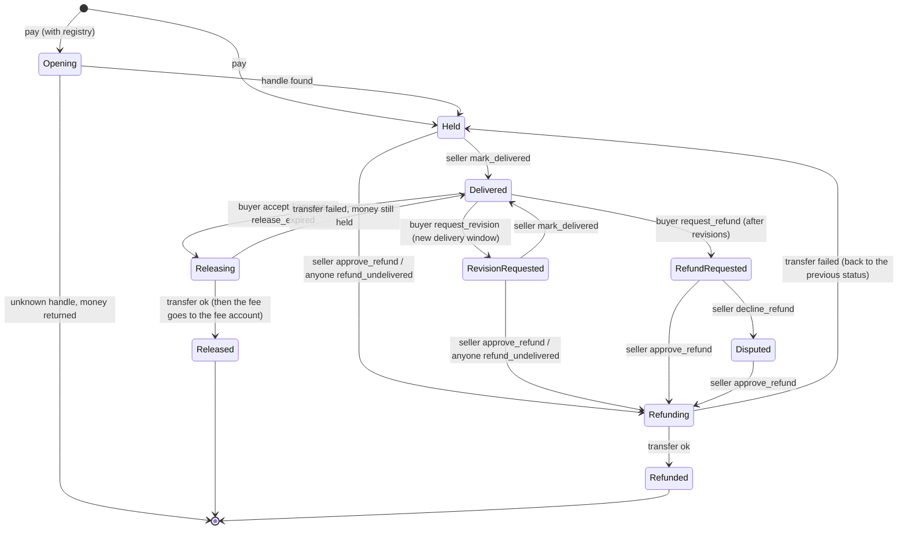

# Escrow

Take payments for goods and services on NEAR: the buyer's tokens wait in a contract until delivery, then go to the
seller when the buyer confirms — or automatically after a timeout. Refunds, revisions and an optional platform fee built in.

## Copy it

1. Copy the folder `kits/market/escrow/` into your project (the TypeScript client at the root, the contract in `contract/`).
2. Install: `npm i near-api-js@7.4.0`
3. Import:

```ts
import { EscrowClient, keySigner, newOrderId, orderStage } from "./escrow/src/index.js";
```

Deploy the contract once (below), or point the client at an escrow someone already deployed.
To try it without deploying: `kitescrow-317528989.testnet` runs this contract on testnet (token `nusd.nearchant.testnet`,
1% fee); register the seller on the token first (see "Deploy").

## Use it

```ts
const escrow = new EscrowClient({ contractId: "escrow.yourshop.testnet" }); // network: "testnet" by default
const buyer = escrow.as(keySigner({ accountId: "buyer.testnet", secretKey: process.env.BUYER_KEY! }));
const seller = escrow.as(keySigner({ accountId: "seller.testnet", secretKey: process.env.SELLER_KEY! }));

const orderId = newOrderId(); // save it with your order first: it is the idempotency key
await buyer.pay({ orderId, seller: "seller.testnet", token: "nusd.nearchant.testnet", amount: "5000000" }); // 5 nUSD (Nearchant's test token: call its `faucet` for free test money)
await seller.markDelivered(orderId);
await buyer.accept(orderId); // seller is paid (minus the fee, if any)

const o = await escrow.getOrder(orderId);
const stage = orderStage(o?.status, "seller"); // { label: "Paid out", note: "The buyer confirmed…", tone: "done" }
```

In a browser wallet, build the transaction yourself: `ft_transfer_call` on the token with
`{ receiver_id: <escrow>, amount, msg: orderMsg(orderId, seller) }`, 1 yoctoNEAR attached, ~150 Tgas.
Any near-api-js `Account` works as a signer via `accountSigner(account)`; anything with `{ accountId, call() }` works too.

Run `npx tsx example.ts` to see the calls (dry run), or set `ESCROW_CONTRACT`, `ESCROW_TOKEN`, `BUYER_ACCOUNT`,
`BUYER_KEY`, `SELLER_ACCOUNT`, `SELLER_KEY` to run one real order on testnet.

### Client methods

| Who | Method | Contract call |
|---|---|---|
| buyer | `pay({ orderId, seller, token, amount, ensureStorage? })` | `ft_transfer_call` on the token (checks the escrow's storage on the token first) |
| buyer | `accept(orderId)` | `accept` — pays the seller |
| buyer | `requestRevision(orderId)` / `requestRefund(orderId)` | ask for a fix / then for the money back |
| seller | `markDelivered(orderId, proofId?)` | `mark_delivered` |
| seller | `approveRefund(orderId)` | refund in full (also how a seller declines an undelivered order) |
| seller | `declineRefund(orderId)` | refund request → `Disputed` |
| anyone | `releaseExpired(orderId)` / `refundUndelivered(orderId)` | timeouts; run them from a cron |
| anyone | `getOrder(orderId)` / `getParams()` | views (validated, not cast) |

`orderStage(status, "seller" | "buyer")` gives a label, a one-line note and a tone (`act` / `wait` / `done` / `bad`)
for order lists.

## Options

`new EscrowClient(options)`:

| Option | Default | What |
|---|---|---|
| `contractId` | — (required) | the escrow contract account |
| `network` | `"testnet"` | `"testnet"` or `"mainnet"` (mainnet is untested) |
| `rpcUrls` | public fastnear + near.org RPCs | your RPC endpoints; several = failover |
| `signer` | none | default signer; or `.as(signer)` per role |
| `view` | JSON-RPC via near-api-js | replace the read function (tests, caching, indexer) |
| `timeoutMs` / `txTimeoutMs` | 15 000 / 60 000 | per read / per transaction |
| `retries` / `retryDelayMs` | 3 / 300 | read retries with exponential backoff + jitter |

Contract init (`new`), all but the first two optional:

| Arg | Default | What |
|---|---|---|
| `owner_id` | — | may call `set_params` |
| `accepted_tokens` | — | NEP-141 contracts buyers may pay with |
| `fee_bps` | 0 | platform fee in basis points (max 1000 = 10%), taken only on release |
| `fee_account_id` | `owner_id` | receives the fee |
| `registry_id` | none | handle registry: `seller` in the msg is a handle, looked up with `get_handle(handle) → {account_id, payout_account_id}` |
| `proof_log_id` | none | proof log: `mark_delivered` then needs a `proof_id` that `is_passed(proof_id, subject = order_id, author_id = seller)` confirms (the `content/proof-log` kit has this method) |
| `release_after_ns` | 2 days | after delivery, anyone can release to the seller |
| `delivery_deadline_ns` | 7 days | if not delivered by then, anyone can refund the buyer |
| `max_revisions` | 1 | fixes a buyer may ask for before a refund request |
| `min_amount` | `"1"` | smallest order in token base units (set it to keep storage spam expensive) |

## How it works

The buyer calls `ft_transfer_call` on the token with
`msg = {"order_id": "<your id, 1..128 chars>", "seller": "<seller.near or handle>"}`. The token calls the escrow's
`ft_on_transfer`, which creates the order. A bad msg, a repeated order id, an amount below `min_amount` or an
unknown seller returns the full amount to the buyer (so checkout retries are safe); a token that isn't accepted is
refused the same way.



- Payouts are `ft_transfer`s with a callback: if one fails (e.g. the seller isn't registered on the token), the order
  goes back to its previous status with the money still held. The fee is sent only after the seller's transfer succeeded.
- Each order keeps the windows and fee it was created with; `set_params` (owner only) changes new orders only.
- Events are NEP-297 logs: `EVENT_JSON:{"standard":"escrow","version":"1.0.0","event":"order_created",…}` for
  `order_created`, `order_delivered`, `order_revision_requested`, `order_refund_requested`, `order_disputed`,
  `order_released`, `order_refunded`.
- Sellers can sign with a function-call key limited to this contract (`mark_delivered`, `approve_refund`,
  `decline_refund`): those calls can only deliver or give money back to the buyer.
- The client's `pay` is idempotent by `orderId`: it looks the order up first, and after a timeout it checks the chain
  before reporting an error. Other calls are never blindly retried (the contract rejects repeats anyway); on a timeout,
  read `getOrder` and decide.

### Deploy

Needs Rust, `cargo-near` and `near` (near-cli-rs).

```sh
cd contract
cargo near build non-reproducible-wasm            # → target/near/escrow.wasm
near account create-account fund-myself escrow.you.testnet '5 NEAR' autogenerate-new-keypair save-to-keychain \
  sign-as you.testnet network-config testnet sign-with-keychain send
near contract deploy escrow.you.testnet use-file target/near/escrow.wasm \
  with-init-call new json-args '{"owner_id":"you.testnet","accepted_tokens":["nusd.nearchant.testnet"],"fee_bps":100,"fee_account_id":"you.testnet"}' \
  prepaid-gas '100.0 Tgas' attached-deposit '0 NEAR' network-config testnet sign-with-keychain send
# The escrow, every seller and the fee account must be registered on each token (NEP-145) to receive it:
near contract call-function as-transaction nusd.nearchant.testnet storage_deposit \
  json-args '{"account_id":"escrow.you.testnet","registration_only":true}' \
  prepaid-gas '30.0 Tgas' attached-deposit '0.0125 NEAR' sign-as you.testnet network-config testnet sign-with-keychain send
```

The contract is its own Cargo workspace (empty `[workspace]` in its `Cargo.toml`), so it builds the same inside
another Rust repo. See `contract/README.md` for its tests.

## Tested

- **Contract** (`cd contract && cargo test`, near-workspaces sandbox, 13 tests): pay → deliver → accept → payout;
  only the seller marks delivered, only the buyer accepts; duplicate id / below minimum / invalid seller / bad msg
  returned in full; a non-allowlisted token rejected with the buyer's balance intact; revision → refund request →
  seller approves; seller declines an undelivered order; decline refund → `Disputed` → later refund; release after the
  window by a stranger; refund of an undelivered order after the deadline; revision restarts the delivery window;
  2.5% fee split to the fee account (and no fee on refunds); failed payout reverts the status and keeps the money;
  optional registry (handle → seller + separate payout account, unknown handle refunded); optional proof log (missing,
  failed, someone else's or another order's proof rejected); `set_params` owner-only with the 10% cap. The tests run
  without a registry or proof log unless they test those. They build two test-only contracts from
  `contract/tests/fixtures` (a NEP-141 token and a mock registry + proof log).
- **Client** (`npm test`, no network, 18 tests): `pay` args and msg format, idempotency, other-buyer id clash,
  returned payment, storage check and `ensureStorage`, recovery after a send timeout, panic messages, input
  validation (U128 strings), every action's method/args/signer, no retries on writes, read retries/backoff/timeout,
  validation of chain data, `rpcView` through near-api-js against a fake JSON-RPC `fetch`, `orderStage` wording.
- **Not tested**: a live testnet run of `example.ts` (it needs funded accounts), mainnet, and real third-party tokens
  (USDC etc.) beyond the standard NEP-141 test token. Contract not audited.

## Came from

`contracts/orders` in Nearchant, where it holds every store order (nUSD/USDC) between checkout and payout, with
the `handles` contract as registry and `proof-log` checked on delivery. Changes for general use: the seller can be
any account (registry and proof log are optional), the order msg field is `seller` (was `seller_handle`), the proof
check calls `is_passed(proof_id, subject, author_id)` (Nearchant's deployed proof-log names that argument
`order_id`), the fee is fixed per order at payment time, the minimum order and all windows are init options, the
event standard is `escrow`, and the order fields are `seller` / `seller_id` / `payout_id` / `fee_bps`.
